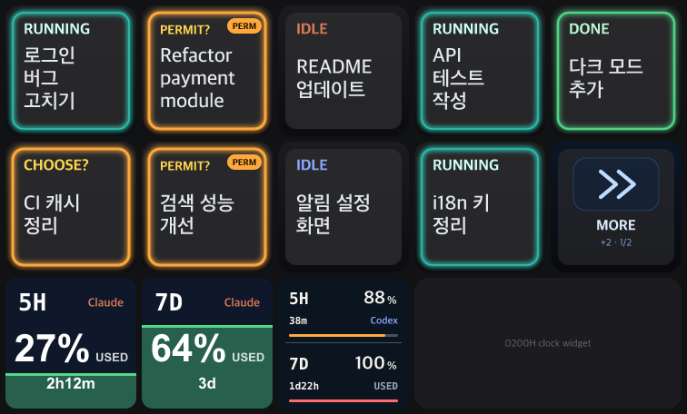

# ulanzi-orca-plugin

[English](README.md) | [한국어](README.ko.md) | **日本語** | [简体中文](README.zh-CN.md)

Ulanzi D200H に [Orca](https://orca.dev) のエージェントセッションと Claude・Codex の残り利用枠を表示する Ulanzi Studio プラグインです（macOS）。



- **セッションスロット**：複数のキーに置くと、Orca のセッションがキーの位置順に埋まります。新しいセッションは次の空きスロットに入り、閉じたセッションは抜けて後ろが詰まります。押すと Orca がそのセッションに切り替わり、長押しすると承認・停止・クイック返信ボタンのある詳細画面が開きます。
- **その他のセッション**：セッションがスロットより多いとき、次のページに送ります。
- **残り利用枠**：Claude の 5 時間／週間、Codex の 5 時間／週間の使用率とリセットまでの残り時間。押すと使用済み % と残り % が切り替わります。
- **Claude バディ**：全体の状況に応じて動く Clawd。押すと最も急ぎのセッションに切り替わります。

キーのデザインは [AgentDeck](https://puritysb.github.io/AgentDeck/) の D200H レンダラーに準拠しています（MIT、[THIRD-PARTY-NOTICES.md](THIRD-PARTY-NOTICES.md)）。

## インストール

1. Orca の **Settings → Experimental → CLI** で `orca` CLI を登録します。
2. このリポジトリを取得して `npm run install:local` を実行します（または Releases の zip を展開して `~/Library/Application Support/Ulanzi/UlanziDeck/Plugins/` に置きます）。
3. Ulanzi Studio を再起動し、**Orca** カテゴリのアクションをキーにドラッグします。
   - 上 2 段：セッションスロット 9 個 + 2 段目の最後のキーに「その他のセッション」
   - 下段の左 3 キー：残り利用枠 3 個（Claude 5H、Claude 7D、Codex 5H+7D が自動で割り当てられます）

キーの見方、設定、トラブルシューティングは[プラグインの README](com.ulanzi.orcasessions.ulanziPlugin/README.md)（韓国語）を参照してください。

## 開発

Node.js 20 以上が必要です。

```bash
npm run setup          # プラグインのランタイム依存（ws、GIF 用の resvg-wasm・gifenc）をインストール
npm test               # 偽の Orca・偽の Ulanzi Studio でシナリオテスト
npm run preview        # テスト後に test/out/preview.html を生成 → ブラウザでキーの見た目を確認
npm run install:local  # この Mac の Ulanzi Studio にインストール（インストール後に Studio を再起動）
npm run package        # dist/ に配布用 zip を作成
```

テストは実際の Orca、キーチェーン、ネットワークには触れません。実機でデバッグするには Ulanzi Studio を `--log --nodeRemoteDebug` オプション付きで起動し、Chrome の `chrome://inspect` からメインサービスを確認してください。

構成や設計判断、注意点は [CLAUDE.md](CLAUDE.md)（韓国語）にまとめています。

## 構成

```
com.ulanzi.orcasessions.ulanziPlugin/   プラグイン本体（このフォルダがそのままインストールされる）
  manifest.json                         4 つのアクションの定義
  plugin/app.js                         メインサービス：ポーリング、スロット割り当て、キー入力
  plugin/orca.js                        orca CLI の実行（macOS の PATH を補正）
  plugin/usage.js                       Claude・Codex の使用量を取得
  plugin/render.js                      キーの SVG レンダラー（AgentDeck デザイン）
  plugin/buddy.js                       Claude バディキー
  plugin/gif.js                         動くキーの GIF を生成
  plugin/ulanzi/, libs/                 Ulanzi 公式 SDK（Apache-2.0、変更しない）
  property-inspector/inspector.html     設定画面（4 つのアクションで共用）
test/                                   シナリオテストと偽の orca・使用量 API
scripts/                                ローカルインストール、パッケージング
```

## ライセンス

[MIT](LICENSE)。ただし `com.ulanzi.orcasessions.ulanziPlugin/plugin/ulanzi/` と `libs/` は Ulanzi 公式 SDK（Apache-2.0）、キーのデザインは AgentDeck（MIT）から取り入れています — [THIRD-PARTY-NOTICES.md](THIRD-PARTY-NOTICES.md)。
