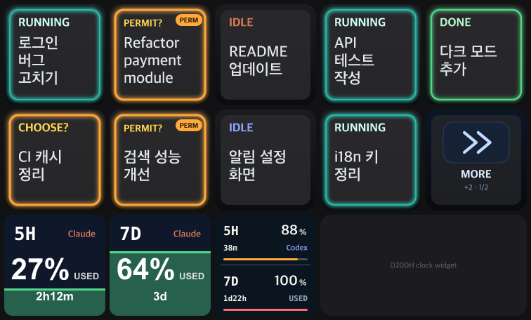

# ulanzi-orca-plugin

Ulanzi D200H에 [Orca](https://orca.dev)의 에이전트 세션과 Claude·Codex 남은 한도를 띄우는 Ulanzi Studio 플러그인 (macOS).



- **세션 슬롯**: 여러 키에 깔아 두면 Orca 세션이 키 위치 순서대로 채워집니다. 세션이 생기면 다음 빈 칸에 들어가고, 닫히면 빠지면서 뒤쪽이 당겨집니다. 누르면 Orca가 그 세션으로 전환됩니다.
- **더보기**: 세션이 슬롯보다 많을 때 다음 페이지로 넘깁니다.
- **남은 한도**: Claude 5시간/주간, Codex 5시간/주간의 남은 비율과 초기화까지 남은 시간.

키 디자인은 [AgentDeck](https://puritysb.github.io/AgentDeck/)의 D200H 렌더러를 따릅니다 (MIT, [THIRD-PARTY-NOTICES.md](THIRD-PARTY-NOTICES.md)).

## 설치 (사용자)

1. Orca에서 **Settings → Experimental → CLI**로 `orca` CLI를 등록합니다.
2. 이 저장소를 받은 뒤 `npm run install:local` (또는 Releases의 zip을 풀어 `~/Library/Application Support/Ulanzi/UlanziDeck/Plugins/`에 넣기)
3. Ulanzi Studio를 재시작하고, **Orca** 분류의 액션을 키에 드래그합니다.
   - 위 두 줄: 세션 슬롯 9개 + 둘째 줄 마지막 칸에 더보기
   - 아랫줄 왼쪽 3칸: 남은 한도 3개 (Claude 5H, Claude 7D, Codex 5H+7D가 자동 배정)

키 읽는 법, 설정, 문제 해결은 [플러그인 README](com.ulanzi.orcasessions.ulanziPlugin/README.md)를 보세요.

## 개발

Node.js 20 이상이 필요합니다.

```bash
npm run setup          # 플러그인 런타임 의존성(ws) 설치
npm test               # 가짜 Orca·가짜 Ulanzi Studio로 시나리오 테스트
npm run preview        # 테스트 후 test/out/preview.html 생성 → 브라우저로 키 모양 확인
npm run install:local  # 이 Mac의 Ulanzi Studio에 설치 (설치 후 Studio 재시작)
npm run package        # dist/에 배포용 zip
```

테스트는 실제 Orca, 키체인, 네트워크를 건드리지 않습니다. 실제 기기에서 디버깅하려면 Ulanzi Studio를 `--log --nodeRemoteDebug` 옵션으로 실행하고 Chrome의 `chrome://inspect`에서 메인 서비스를 확인하세요.

구조와 설계 결정, 주의할 점은 [CLAUDE.md](CLAUDE.md)에 정리되어 있습니다.

## 구조

```
com.ulanzi.orcasessions.ulanziPlugin/   플러그인 본체 (이 폴더가 그대로 설치됨)
  manifest.json                         액션 3개 정의
  plugin/app.js                         메인 서비스: 폴링, 슬롯 배정, 키 입력
  plugin/orca.js                        orca CLI 실행 (macOS PATH 보정)
  plugin/usage.js                       Claude·Codex 사용량 조회
  plugin/render.js                      키 SVG 렌더러 (AgentDeck 디자인)
  plugin/ulanzi/, libs/                 울란지 공식 SDK (Apache-2.0, 수정하지 않음)
  property-inspector/inspector.html     설정 화면 (세 액션 공용)
test/                                   시나리오 테스트와 가짜 orca·사용량 API
scripts/                                로컬 설치, 패키징
```

## 라이선스

[MIT](LICENSE). 단, `com.ulanzi.orcasessions.ulanziPlugin/plugin/ulanzi/`와 `libs/`는 Ulanzi 공식 SDK(Apache-2.0), 키 디자인은 AgentDeck(MIT)에서 가져왔습니다 — [THIRD-PARTY-NOTICES.md](THIRD-PARTY-NOTICES.md).
