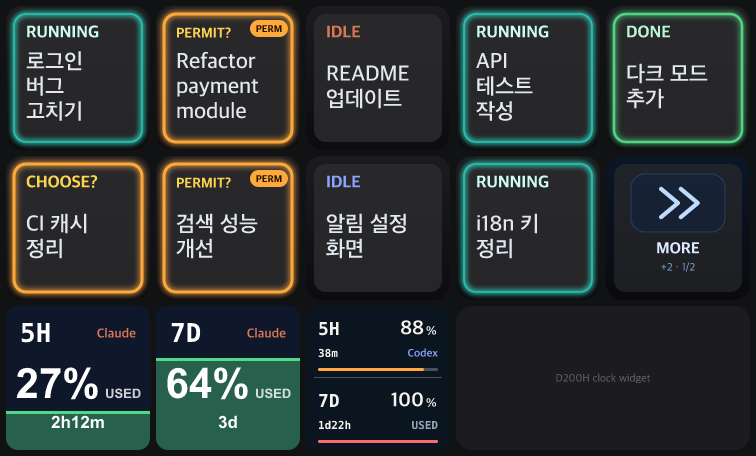

# ulanzi-orca-plugin

[English](README.md) | [한국어](README.ko.md) | [日本語](README.ja.md) | **简体中文**

一个 Ulanzi Studio 插件，在 Ulanzi D200H 上显示 [Orca](https://orca.dev) 的智能体会话以及 Claude、Codex 的剩余用量额度（macOS）。



- **会话槽位**：放在多个按键上，Orca 会话会按按键位置顺序填入。新会话进入下一个空槽位，关闭的会话会移出，后面的依次前移。按下即可让 Orca 切换到该会话；长按会打开带有批准、停止、快捷回复按钮的详情界面。
- **更多会话**：会话数多于槽位时翻到下一页。
- **剩余额度**：Claude 5 小时／每周、Codex 5 小时／每周的使用率，以及距重置的剩余时间。按下可在已用 % 和剩余 % 之间切换。
- **Claude 伙伴**：根据整体状态做出动作的 Clawd。按下会切换到最紧急的会话。

按键设计沿用 [AgentDeck](https://puritysb.github.io/AgentDeck/) 的 D200H 渲染器（MIT，[THIRD-PARTY-NOTICES.md](THIRD-PARTY-NOTICES.md)）。

## 安装

1. 在 Orca 中通过 **Settings → Experimental → CLI** 注册 `orca` CLI。
2. 获取本仓库后运行 `npm run install:local`（或将 Releases 中的 zip 解压到 `~/Library/Application Support/Ulanzi/UlanziDeck/Plugins/`）。
3. 重启 Ulanzi Studio，将 **Orca** 分类中的操作拖到按键上。
   - 上面两行：9 个会话槽位 + 第二行最后一个按键放“更多会话”
   - 最下面一行左侧 3 个按键：3 个剩余额度（自动分配为 Claude 5H、Claude 7D、Codex 5H+7D）

按键含义、设置和故障排除请参阅[插件 README](com.ulanzi.orcasessions.ulanziPlugin/README.md)（韩语）。

## 开发

需要 Node.js 20 或更高版本。

```bash
npm run setup          # 安装插件运行时依赖（ws，以及用于 GIF 的 resvg-wasm、gifenc）
npm test               # 使用模拟的 Orca 和模拟的 Ulanzi Studio 运行场景测试
npm run preview        # 测试后生成 test/out/preview.html → 在浏览器中查看按键外观
npm run install:local  # 安装到本机的 Ulanzi Studio（安装后重启 Studio）
npm run package        # 在 dist/ 中生成发布用 zip
```

测试不会触及真实的 Orca、钥匙串或网络。要在真机上调试，请使用 `--log --nodeRemoteDebug` 选项启动 Ulanzi Studio，并在 Chrome 的 `chrome://inspect` 中查看主服务。

架构、设计决策和注意事项记录在 [CLAUDE.md](CLAUDE.md)（韩语）中。

## 目录结构

```
com.ulanzi.orcasessions.ulanziPlugin/   插件本体（此文件夹会被原样安装）
  manifest.json                         定义 4 个操作
  plugin/app.js                         主服务：轮询、槽位分配、按键输入
  plugin/orca.js                        执行 orca CLI（修正 macOS PATH）
  plugin/usage.js                       查询 Claude、Codex 用量
  plugin/render.js                      按键 SVG 渲染器（AgentDeck 设计）
  plugin/buddy.js                       Claude 伙伴按键
  plugin/gif.js                         生成动态按键 GIF
  plugin/ulanzi/, libs/                 Ulanzi 官方 SDK（Apache-2.0，未修改）
  property-inspector/inspector.html     设置界面（四个操作共用）
test/                                   场景测试以及模拟的 orca、用量 API
scripts/                                本地安装、打包
```

## 许可证

[MIT](LICENSE)。其中 `com.ulanzi.orcasessions.ulanziPlugin/plugin/ulanzi/` 和 `libs/` 为 Ulanzi 官方 SDK（Apache-2.0），按键设计取自 AgentDeck（MIT）—— 见 [THIRD-PARTY-NOTICES.md](THIRD-PARTY-NOTICES.md)。
